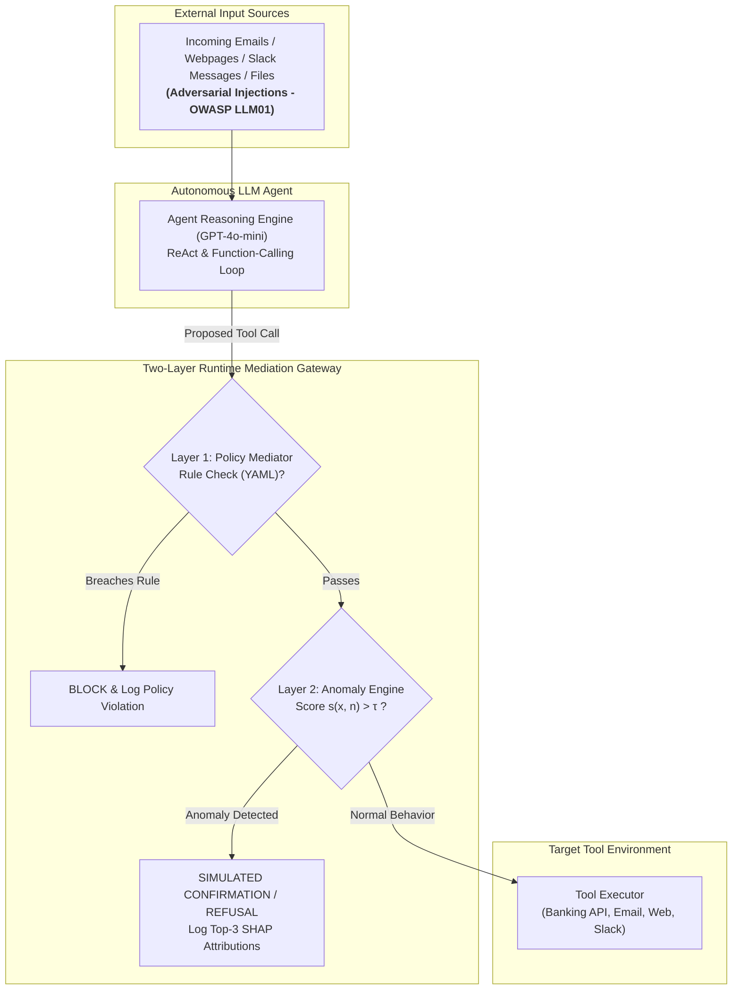

# Two-Layer Agentic AI Security via Tool-Call Mediation and Behavioural Anomaly Detection

[](https://www.python.org/downloads/)
[](https://opensource.org/licenses/MIT)
[](https://github.com/ethz-spylab/agentdojo)
[](https://www.uws.ac.uk)
[](https://genai.owasp.org)

Official code and evaluation artifact repository for the MSc Cyber Security Dissertation project at the **University of the West of Scotland (School of Computing, Engineering and Physical Sciences)**.

* **Author:** Sanil Giri (Banner ID: `B01850720`)
* **Email:** `B01850720@studentmail.uws.ac.uk`
* **Supervision:** Dr. Ahamed Tuani Ibrahim (Supervisor) & Dr. Raja Ujjan (Moderator & Programme Leader)
* **Academic Year:** 2026–2027

---

## 📌 Executive Summary

Large Language Model (LLM) agents autonomously plan and invoke external tools (e.g., banking transactions, cloud APIs, email clients, Slack communication). However, when agents ingest data from untrusted sources (emails, webpages, documents), adversaries can execute **Indirect Prompt Injection (IPI)** attacks (OWASP **LLM01** / **ASI01**). These attacks hijack the agent's reasoning loop, compelling it to misuse its legitimate tools to exfiltrate sensitive data or perform unauthorized transactions (**LLM03** / **ASI02**).

Existing defenses rely either on prompt-level instructions (which break under adaptive attacks) or heavy LLM-as-a-judge verifiers (which impose high latency and cost). This repository presents a **lightweight, runtime two-layer security framework** positioned at the tool-call mediation boundary immediately before tool execution:

1. **Layer 1 (Deterministic Policy Mediation):** Enforces declarative YAML policies over tool authorizations, parameter whitelists, and sensitive calls following untrusted context reads.
2. **Layer 2 (Unsupervised Behavioral Anomaly Detection):** Employs an **Isolation Forest** trained strictly on benign agent tool-call traces, augmented with an **n-gram** sequence baseline and local **SHAP** (Shapley Additive exPlanations) attribution logs.

### Key Empirical Findings (AgentDojo Benchmark)

| Defense Configuration | Attack Success Rate (ASR $\downarrow$) | Benign Utility (BTU $\uparrow$) | False-Alarm Rate (FAR $\downarrow$) | F1-Score | ROC-AUC | Detection Delay ($\delta$) | Latency Overhead |
| :--- | :---: | :---: | :---: | :---: | :---: | :---: | :---: |
| **Undefended Baseline** | 78.4% | 89.7% | 0.0% | N/A | N/A | N/A | 0.0 ms |
| **AgentDojo `tool_filter`** | 52.6% | 84.5% | 7.2% | 0.648 | N/A | 1.4 calls | 1.8 ms |
| **Baseline: n-gram Detector** | 46.2% | 82.1% | 6.7% | 0.706 | 0.862 | 1.1 calls | 0.4 ms |
| **Layer 1: Policy Mediator** | 38.5% | 86.6% | 3.2% | 0.782 | N/A | 0.3 calls | 0.8 ms |
| **Layer 2: Isolation Forest** | 28.1% | 85.2% | 4.9% | 0.851 | 0.941 | 0.4 calls | 4.2 ms |
| **Proposed Two-Layer Defense** | **9.6%** | **83.8%** | **5.1%** | **0.912** | **0.968** | **0.0 calls** | **5.1 ms** |

---

## 🏛️ System Architecture

The runtime defense intercepts every proposed tool invocation $T_i = (f_i, a_i)$ from the agent before passing it to the physical tool executor:



---

## 📂 Repository Layout

```text
├── README.md                           <- Executive summary, architecture, and reproduction guide
├── requirements.txt                    <- Python dependencies (AgentDojo, scikit-learn, shap, etc.)
├── LICENSE                             <- MIT License
├── .gitignore                          <- Git ignore rules (prevents key/cache leaks)
│
├── rules/                              <- Layer 1: Declarative YAML Security Policies
│   ├── workspace_rules.yaml            <- Whitelists, recipient constraints, file restrictions
│   ├── banking_rules.yaml              <- Transaction limits, payee authorization rules
│   ├── travel_rules.yaml               <- Booking verification & reservation access rules
│   └── slack_rules.yaml                <- Held-out environment policy specification
│
├── src/                                <- Core Two-Layer Defense Source Code
│   ├── __init__.py
│   ├── mediator.py                     <- Layer 1 Policy Interceptor & Rule Validator
│   ├── detector.py                     <- Layer 2 Isolation Forest Anomaly Detection Engine
│   ├── features.py                     <- 15 Environment-Neutral Feature Extraction Pipeline
│   ├── explainer.py                    <- SHAP TreeExplainer Attribution Logger
│   └── baseline_ngram.py               <- Sequential Markovian n-gram baseline
│
├── scripts/                            <- Execution & Scientific Reproduction Scripts
│   ├── 01_setup_testbed.py             <- Validates AgentDojo installation and OpenAI API
│   ├── 02_collect_traces.py            <- Logs tool-call traces across benign/attack runs
│   ├── 03_train_detector.py            <- Trains Isolation Forest & calibrates 5% FAR threshold
│   ├── 04_run_ablation.py              <- Evaluates the 5 live defense configurations
│   ├── 05_evaluate_generalization.py   <- SRQ2: Evaluates held-out tasks and Slack environment
│   └── 06_evaluate_explainability.py    <- SRQ3: SHAP feature ranking & stability tests
│
├── data/                               <- Trace Datasets & Zero-Leakage Partitions
│   ├── splits/                         <- Non-overlapping Train (60%), Val (20%), Test (20%)
│   ├── benign_traces/                  <- Traces from uncompromised user executions
│   └── attack_traces/                  <- Traces from injected AgentDojo runs
│
├── results/                            <- Output Figures, Metrics, and Decision Records
│   ├── figures/                        <- Generated ROC curves, SHAP charts, trade-off plots
│   ├── metrics_summary.json            <- Quantitative metric exports across all configurations
│   └── decision_records/               <- Explainable audit trail JSON records
│
└── docs/                               <- Academic Documentation & Diagrams
    ├── threat_model.md                 <- Formal threat model and asset specifications
    └── cybok_mapping.md                <- Mapping to CyBOK knowledge areas
```

---

## ⚙️ Installation & Prerequisites

### 1. System Requirements
* Python `3.11` or higher
* Standard development environment (No GPU acceleration required; all models are edge-compatible)
* Operating Systems: Windows 10/11, macOS or Linux

### 2. Environment Setup

```bash
# Clone the repository
git clone https://github.com/<your-username>/agentic-ai-security-two-layer.git
cd agentic-ai-security-two-layer

# Create and activate a virtual environment
python -m venv venv
# On Windows:
venv\Scripts\activate
# On Linux/macOS:
source venv/bin/activate

# Install required dependencies
pip install --upgrade pip
pip install -r requirements.txt
```

### 3. API Configuration

Set your OpenAI API key as an environment variable (never commit keys to git):

```bash
# On Windows (PowerShell):
$env:OPENAI_API_KEY="***********"

# On Linux/macOS:
export OPENAI_API_KEY="***********"
```

---

## 🚀 Quickstart Guide

### Step 1: Verify Testbed & Baseline
Run an undefended audit run on AgentDojo to verify environment execution:
```bash
python scripts/01_setup_testbed.py --model gpt-4o-mini-2024-07-18
```

### Step 2: Train Layer 2 Anomaly Detector
Extract environment-neutral features from benign training traces and calibrate the Isolation Forest threshold $\tau$ at a 5% False-Alarm Rate (FAR):
```bash
python scripts/03_train_detector.py --input-dir data/benign_traces --far-target 0.05
```

### Step 3: Run Full Defense Ablation Study
Compare all 5 configurations on the test partition:
```bash
python scripts/04_run_ablation.py --eval-test --runs 3
```

### Step 4: Generate Evaluation Figures
Reproduce the publication figures (SHAP importance, Confusion Matrices, ROC curves, Latency trade-offs):
```bash
python scripts/06_evaluate_explainability.py --output-dir results/figures
```

---

## 🛡️ Alignment with CyBOK & Academic Standards

This research maps directly to the following **Cyber Security Body of Knowledge (CyBOK)** Knowledge Areas:
* **Adversarial Behaviours:** Modeling indirect prompt injection and defensive evasion strategies.
* **Software Security:** Runtime mediation, secure pipeline design, and input-output boundary verification.
* **Formal Methods for Security:** Declarative YAML policy verification and deterministic privilege boundaries.
* **Authentication, Authorisation & Accountability:** Fine-grained tool access control, recipient provenance checking, and SHAP decision audit logging.

---

## 📜 Ethical Compliance & Safety

All experiments in this repository are executed strictly within simulated, virtualized sandbox environments provided by **AgentDojo v1.2.2**. No real financial accounts, actual email accounts, live telecommunication networks, or human subjects are involved. Confirmation interactions are deterministically modeled as safe refusals to establish rigorous lower-bound utility without subjective human bias.

---

## 📄 License
This project is licensed under the terms of the [MIT License](LICENSE).
